# Дневник смен

Мобильное приложение для водителя такси. Водитель записывает поездки: время, сумму, комиссию парка, способ оплаты. Приложение показывает итоги дня: сколько получено на руки, выручку, комиссию, число поездок, долю наличных и карты.

С версии 2.0:
- **вход по логину и паролю** и две роли: водитель и администратор;
- **вывод денег:** водитель видит, сколько парк ему должен, и создаёт заявку на вывод;
- **админка:** поездки всех водителей, заявки на вывод («Выплатить» / «Отклонить»), водители и их балансы;
- **два языка:** русский и казахский, переключаются на экране входа и в меню.

Состав репозитория:
- `apps/mobile` — Flutter-приложение;
- `packages/design_kit` — дизайн-кит;
- `backend` — API на FastAPI с PostgreSQL, развёрнут на Railway.

| Вход | День | Вывод средств | Админка |
|---|---|---|---|
| 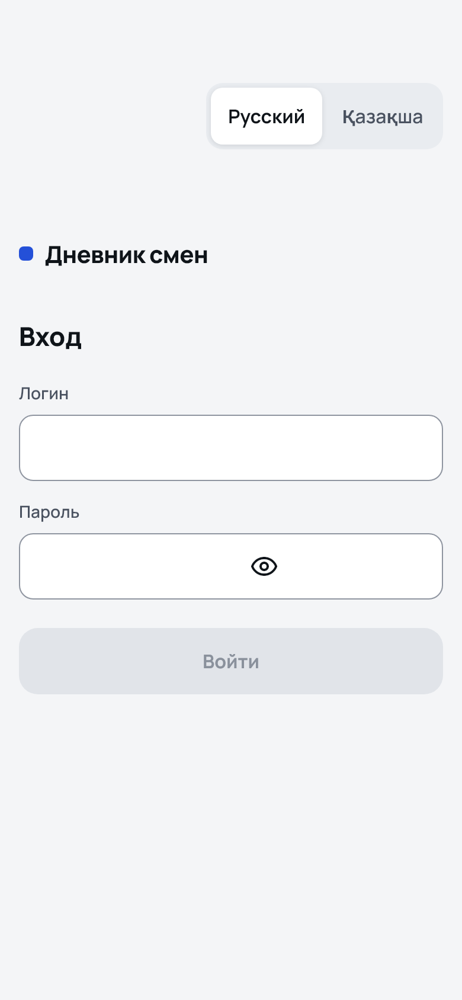 | 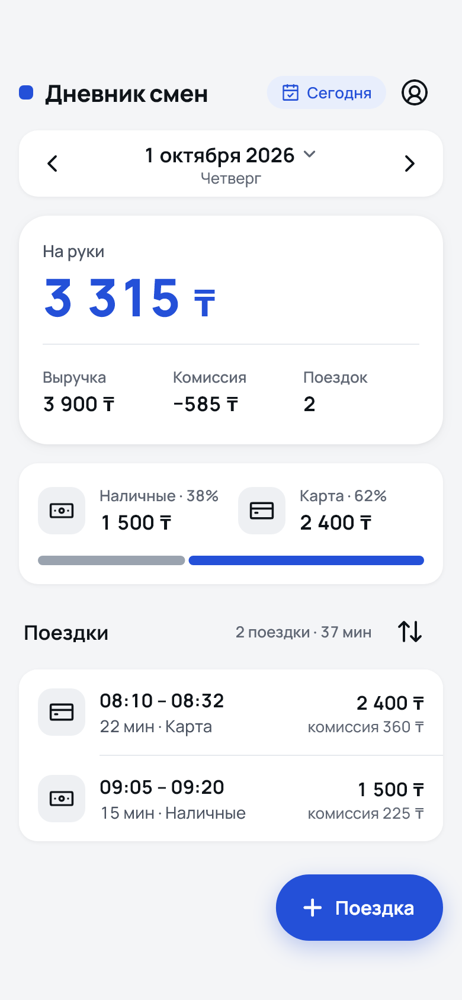 | 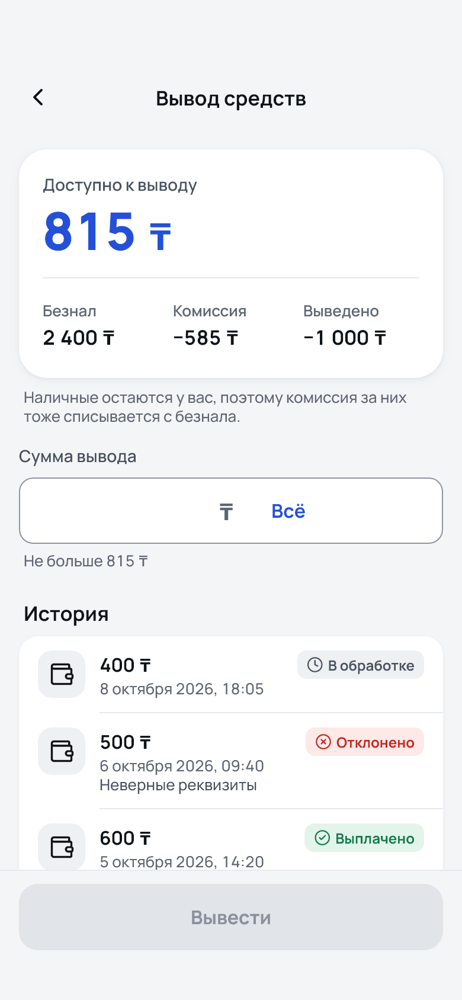 | 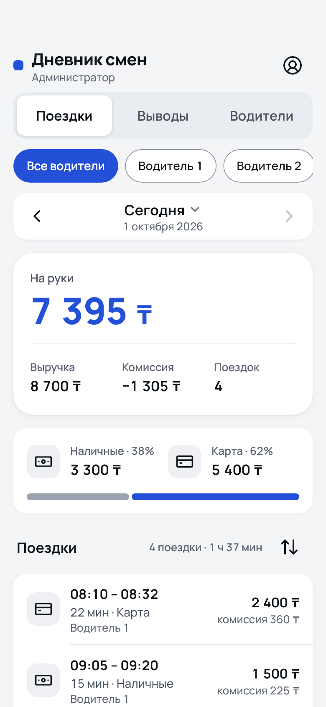 |

**Скачать APK для Android:** [driver-diary.apk (v2.0.1)](https://github.com/alisherizmukhan/arqa-demo/releases/download/v2.0.1/driver-diary.apk) (все релизы — на странице [Releases](https://github.com/alisherizmukhan/arqa-demo/releases)). Приложение работает с развёрнутым API, ничего настраивать не нужно. Войдите демо-аккаунтом: `user_1` / `password_1` (водитель) или `admin` / `admin` (администратор), полный список — в разделе «Демо-аккаунты».

> **Старые сборки больше не работают с сервером.** С версии 2.0 API требует вход, а APK v0.1.0 и код по тегу `v1.0` (сдача до этапа аккаунтов) входить не умеют: их запросы получают 401. Ставьте v2.0.1.

### Демо-видео

<!-- Сюда вставить видео: откройте README.md на GitHub → «Edit» → перетащите .mp4 в это место.
     GitHub сам подставит ссылку вида https://github.com/user-attachments/assets/…
     Эту заметку и строку «Видео скоро появится» после этого можно удалить. -->


https://github.com/user-attachments/assets/44a51387-0f43-486c-87e7-9e07c062bf56


---

## Требования задания

Эталонный день — **2026-10-01**: 2 поездки, выручка 3 900 ₸, комиссия 585 ₸, на руки 3 315 ₸, наличные 1 500 ₸, карта 2 400 ₸. Эти числа проверяются тестами бэкенда и клиента, а также на развёрнутом API. С аккаунтами это день `user_1`; у `user_2` в тот же день 4 800 / 720 / 4 080 ₸, у администратора по всем водителям — 8 700 / 1 305 / 7 395 ₸ (проверка развёрнутого API — в [`docs/DEPLOY_CHECK.md`](docs/DEPLOY_CHECK.md)).

| Требование | Статус | Где реализовано | Какой тест доказывает |
|---|---|---|---|
| API: поездки за день и итоги дня | ✅ | `backend/app/api/routes.py` (`GET /trips`, `GET /summary`), `backend/app/domain/summary.py`, `backend/app/domain/day.py` | `backend/tests/integration/test_api_trips.py::test_reference_case_summary`, `::test_reference_case_trips`; `backend/tests/unit/domain/test_summary.py::test_reference_case_from_assignment` |
| Клиент: итоги дня, список поездок, переключение дней | ✅ | `apps/mobile/lib/features/trips/presentation/screens/day_screen.dart`, `apps/mobile/lib/features/trips/domain/entities/daily_summary.dart`, `apps/mobile/lib/features/trips/presentation/providers/trips_providers.dart` | `apps/mobile/test/features/trips/domain/domain_test.dart` («reference case 2026-10-01»); `apps/mobile/test/features/trips/presentation/screens_test.dart` («renders the reference day»); `apps/mobile/test/features/trips/presentation/providers_test.dart` («each day is fetched once…») |
| Создание поездки с валидацией (сумма > 0, конец позже начала) | ✅ | `apps/mobile/lib/features/trips/presentation/screens/add_trip_screen.dart`, `apps/mobile/lib/features/trips/domain/entities/trip_rules.dart`, `backend/app/domain/trip.py` | `apps/mobile/test/features/trips/presentation/trip_form_test.dart`; `backend/tests/unit/domain/test_trip.py::test_invalid_trip_is_rejected`; `backend/tests/integration/test_api_validation.py` |
| Нет дублей при повторной отправке | ✅ | `backend/app/infrastructure/repository.py` (`INSERT … ON CONFLICT (id) DO NOTHING`), `backend/app/application/use_cases.py`; в клиенте `AddTripController` в `trips_providers.dart` и повторы в `add_trip_screen.dart` | `backend/tests/integration/test_idempotency.py` (повтор → 200, гонка параллельных POST → одна строка, другие данные → 409); `providers_test.dart` («retrying the same trip after a network error reuses its id»); `apps/mobile/test/features/trips/presentation/form_behaviour_test.dart` («resent with the same id») |
| Аккаунты, роли, сессии | ✅ | `backend/app/application/auth.py`, `access.py`; в приложении `features/auth` | `backend/tests/integration/test_auth_api.py`, `test_scoping_api.py`; `apps/mobile/test/features/accounts/` |
| Вывод денег без двойного списания | ✅ | `backend/app/application/withdrawals.py` (блокировка строки водителя), `features/withdrawals` в приложении | `backend/tests/integration/test_withdrawals_api.py` (параллельные заявки); повторы с тем же `id` — `accounts_behaviour_test.dart` |
| Русский и казахский | ✅ | `apps/mobile/lib/l10n/app_ru.arb`, `app_kk.arb`, [`docs/L10N.md`](docs/L10N.md) | `test/core/l10n_format_test.dart`; матрица вёрстки на обоих языках; CI запрещает кириллицу в коде вне локализаций |
| Тесты на итоги и на дубли | ✅ | `backend/tests/`, `apps/mobile/test/`, CI в `.github/workflows/ci.yml` | бэкенд: 372 теста; приложение: 531; дизайн-кит: 183 и витрина 150. Все проходят в CI |
| README, деплой, скриншоты | ✅ | `README.md`, `backend/Dockerfile`, `.railway/railway.ts`, `docs/screenshots/` | `GET /health` на Railway отвечает 200; скриншоты рендерит `apps/mobile/test/screens/screenshots_test.dart` |

---

## Как запустить

Нужны Flutter 3.47.6 (Dart 3.13), Python 3.12 с [uv](https://docs.astral.sh/uv/) и Docker.

### Бэкенд локально

```bash
docker compose up -d db          # PostgreSQL 16 на localhost:5433 (+ база driver_diary_test для тестов)
cd backend
uv sync
uv run alembic upgrade head      # создать схему
uv run python -m app             # http://127.0.0.1:8000/docs; при старте создаются демо-аккаунты и поездки из data/trips.json
```

Весь стек в Docker: `docker compose --profile full up --build`, API на http://localhost:8000/docs.

Настройки берутся из переменных окружения:

| Переменная | Значение |
|---|---|
| `APP_ENV` | `local` (по умолчанию), `test` или `production`. Docker-образ задаёт `production` |
| `DATABASE_URL` | Строка подключения к PostgreSQL. При `APP_ENV=production` обязательна: без неё API не запустится. Локально по умолчанию — база из docker compose |
| `PORT` | Порт API |
| `SEED_ON_STARTUP` | Один переключатель для всех демо-данных: демо-аккаунты и поездки из `SEED_FILE` (по умолчанию `true`). Добавляет только то, чего нет; существующие данные не трогает |
| `SEED_FILE` | Файл с поездками для заполнения |
| `SEED_ADMIN_PASSWORD`, `SEED_USER1_PASSWORD`, `SEED_USER2_PASSWORD` | Пароли демо-аккаунтов (см. ниже) |
| `CLIENT_IP_HEADER` | Заголовок, который ставит сам прокси перед API и перезаписывает присланное клиентом значение. На Railway это `x-real-ip`. По нему определяется IP клиента для лимита входов |
| `TRUSTED_PROXY_HOPS` | Для прокси, которые дописывают клиента в `X-Forwarded-For`: сколько последних записей им принадлежит. Локально оба не заданы — берётся адрес соединения |
| `AUTH_REQUIRED` | `true` (по умолчанию): нужен токен. `false`: запрос без токена работает от имени `user_1`, присланный токен всё равно проверяется (переходный режим, пока приложение не умело входить). На проде — `true` с 2026-10-12 |
| `CORS_ORIGINS` | Разрешённые источники (по умолчанию `["*"]`) |
| `ORS_API_KEY` | Ключ OpenRouteService для маршрутов и адресов (`docs/MAPS.md`). Только на бэкенде; локально — в `backend/.env`, который не коммитится. Без ключа API работает: маршрут строится по прямой, поиск адресов отвечает 503 |
| `ORS_TIMEOUT_SECONDS` / `ORS_BACKGROUND_TIMEOUT_SECONDS` | Тайм-аут ORS: 5 с для запросов, которых ждёт водитель (создание поездки, ручное перестроение), и 30 с для фоновой постройки маршрутов |
| `ROUTE_RETRIES_PER_MINUTE` | Сколько маршрутов в минуту фоновая задача строит заново (по умолчанию 4): маршруты сида и прямые линии после сбоя ORS (`docs/MAPS.md`) |
| `AREA_SOUTH`, `AREA_NORTH`, `AREA_WEST`, `AREA_EAST` | Границы зоны работы (по умолчанию Алматы: 43.05–43.45 с. ш., 76.70–77.20 в. д.). Точки вне неё отклоняются |
| `GEO_REQUESTS_PER_MINUTE`, `GEO_CACHE_HOURS` | Лимит запросов к картам на пользователя в минуту (30) и срок кэша адресов (24 ч) |

#### Демо-аккаунты

> **Это демо-доступы, а не настоящие пароли.** В продакшене задайте свои через переменные окружения.

| Логин | Пароль по умолчанию | Роль | Переменная для пароля |
|---|---|---|---|
| `user_1` | `password_1` | водитель («Водитель 1») | `SEED_USER1_PASSWORD` |
| `user_2` | `password_2` | водитель («Водитель 2») | `SEED_USER2_PASSWORD` |
| `admin` | `admin` | администратор | `SEED_ADMIN_PASSWORD` |

- В базе хранится только хеш пароля (argon2id). Пароли не пишутся в логи.
- **Демо-режим** (`SEED_ON_STARTUP=true`): при каждом старте демо-аккаунты снова активны и с демо-паролями, а админка не даёт их заблокировать или завершить их сессии (409 `demo_account_protected`). Так посетители не сломают общий демо-доступ.
- Если пароль в переменной изменился, при следующем старте хеш обновится.
- Поездки без поля `driver` в `data/trips.json` принадлежат `user_1`. У `user_2` две поездки за 2026-10-01: `u2-t1`, `u2-t2`.
- Роли: водитель видит и создаёт только свои поездки; администратор видит всех водителей и управляет аккаунтами.

#### Railway как код

Настройки сервисов описаны в `.railway/railway.ts` (вместо устаревшего `railway.json`): сборка по `backend/Dockerfile`, healthcheck `/health`, Postgres и его том.

```bash
npm install                      # SDK railway/iac (только для этих команд)
railway config plan              # что изменится на Railway
railway config apply             # применить
```

На Windows с CLI из npm команда падает с «requires Railway CLI 5.42.1 or newer». SDK запускает CLI по переменной `_`, а npm-обёртку Node не запускает. Выполните команду в PowerShell, указав настоящий файл CLI:

```powershell
$env:_ = "$env:APPDATA\npm\node_modules\@railway\cli\bin\railway.exe"; railway config plan
```

### Мобильное приложение

Самый быстрый способ — установить [APK](https://github.com/alisherizmukhan/arqa-demo/releases/download/v2.0.1/driver-diary.apk) (см. ниже). Чтобы собрать из исходников:

```bash
flutter pub get          # из корня репозитория (pub workspace)
cd apps/mobile
flutter devices          # список подключённых устройств и эмуляторов
flutter run              # на первом найденном устройстве, с развёрнутым API
```

По умолчанию приложение ходит в развёрнутый API на Railway. Другой адрес задаётся флагом `--dart-define=API_URL=…`. Часовой пояс водителя — флагом `--dart-define=DRIVER_TZ=+05:00` (это значение по умолчанию). После изменения DTO или провайдеров нужна кодогенерация: `dart run build_runner build`.

Карта: подложка и подпись о данных задаются флагами `--dart-define=TILE_URL_LIGHT=…`, `TILE_URL_DARK=…` (пусто — светлая подложка, затемнённая в тёмной теме) и `TILE_ATTRIBUTION=…`; по умолчанию — стандартные плитки OpenStreetMap и «© OpenStreetMap» (`docs/MAPS.md`). Флаг `--dart-define=THEME=dark` (или `system`) включает тёмную тему для проверки на устройстве; без него приложение светлое.

#### Android: пошагово

**Установить готовый APK на телефон:**

1. Скачайте [driver-diary.apk](https://github.com/alisherizmukhan/arqa-demo/releases/download/v2.0.1/driver-diary.apk) на телефон.
2. Откройте файл. Android попросит разрешить установку из этого источника (браузера или «Файлов») — разрешите.
3. Нажмите «Установить», затем «Открыть». Появится экран входа: введите `user_1` / `password_1`, и откроется день с поездками. Язык переключается кнопками «Русский» / «Қазақша» вверху.

APK подписан отладочным ключом, поэтому Google Play Защита может показать предупреждение. Нажмите «Всё равно установить».

**Запустить из исходников на эмуляторе:**

1. Установите [Android Studio](https://developer.android.com/studio). В Device Manager создайте эмулятор, например Pixel с Android 14+.
2. Проверьте окружение: `flutter doctor` — строка «Android toolchain» должна быть с ✓.
3. Запустите эмулятор: `flutter emulators` покажет список, `flutter emulators --launch <имя>` запустит.
4. В `apps/mobile` выполните `flutter run`.

**Запустить на своём телефоне по USB:**

1. Включите режим разработчика: «Настройки» → «О телефоне» → 7 раз нажмите «Номер сборки».
2. В «Для разработчиков» включите «Отладка по USB». Подключите кабель и подтвердите запрос на телефоне.
3. `flutter devices` должен показать телефон. Затем `flutter run -d <id телефона>`.

**С локальным бэкендом** (сначала поднимите его, см. «Бэкенд локально»):

```bash
# эмулятор: 10.0.2.2 — это localhost компьютера
flutter run --dart-define=API_URL=http://10.0.2.2:8000

# телефон по USB: пробросить порт 8000 телефона на компьютер
adb reverse tcp:8000 tcp:8000
flutter run -d <id телефона> --dart-define=API_URL=http://127.0.0.1:8000
```

Обычный HTTP к локальному бэкенду разрешён только в отладочной сборке. Релизный APK ходит только по HTTPS.

**Собрать APK самому:**

```bash
flutter build apk --release
# файл: apps/mobile/build/app/outputs/flutter-apk/app-release.apk
```

#### iOS: пошагово

iOS-сборка требует macOS и Xcode. Проект собирается из тех же исходников, но на iOS он не проверялся: разработка шла на Windows. Android-сборка (APK и отладочный запуск) проверена на эмуляторе Android.

**Симулятор:**

1. Установите Xcode из App Store и выполните один раз:
   ```bash
   sudo xcode-select --switch /Applications/Xcode.app/Contents/Developer
   sudo xcodebuild -runFirstLaunch
   ```
2. Проверьте окружение: `flutter doctor` — строка «Xcode» должна быть с ✓.
3. Запустите симулятор: `open -a Simulator`.
4. В `apps/mobile` выполните `flutter run`.

С локальным бэкендом в симуляторе: `flutter run --dart-define=API_URL=http://127.0.0.1:8000` — симулятор видит localhost компьютера.

**Свой iPhone:**

1. Подключите iPhone кабелем и нажмите «Доверять этому компьютеру».
2. Откройте `apps/mobile/ios/Runner.xcworkspace` в Xcode.
3. Runner → Signing & Capabilities: выберите свою команду (Team; подойдёт бесплатный Apple ID). Если Xcode пишет, что идентификатор занят, замените Bundle Identifier `kz.driverdiary.driverDiary` на свой.
4. На iPhone включите «Настройки» → «Конфиденциальность и безопасность» → «Режим разработчика» (iOS 16+). Телефон перезагрузится.
5. Выполните `flutter run -d <id iPhone>`. При первом запуске разрешите разработчика: «Настройки» → «Основные» → «VPN и управление устройством».

На iPhone удобнее работать с развёрнутым API (флаг `API_URL` не нужен).

### Тесты

```bash
# Бэкенд (интеграционным тестам нужен Postgres из docker compose)
cd backend
uv run ruff format --check . && uv run ruff check . && uv run mypy
uv run pytest                    # если Windows блокирует pytest.exe: uv run python -m pytest

# Flutter (из корня репозитория)
flutter analyze
(cd packages/design_kit && flutter test)
(cd packages/design_kit/example && flutter test)
(cd apps/mobile && flutter test)

# Контрактные тесты клиента против запущенного бэкенда (с AUTH_REQUIRED=true — с логином)
(cd apps/mobile && LIVE_API_URL=http://127.0.0.1:8000 LIVE_LOGIN=user_1 LIVE_PASSWORD=password_1 flutter test test/live)
```

Перед пушем в `main` все шаги CI (включая проверки `grep`) запускаются одной командой: `tool/ci_local.sh`.

### Голдены: локально и в CI

Голден-тесты ([alchemist](https://pub.dev/packages/alchemist)) бывают двух видов:

| Вид | Где лежат | Текст | Когда сравниваются |
|---|---|---|---|
| Платформенные | `test/goldens/<os>/` (например, `windows/`) | настоящие шрифты, для просмотра | только локально (без переменной `CI`) |
| CI | `test/goldens/ci/` (в приложении `test/screens/goldens/ci/`) | текст рисуется прямоугольниками | только в CI |

```bash
# После намеренного изменения внешнего вида: голдены своей ОС
(cd packages/design_kit && flutter test --update-goldens)
(cd apps/mobile && flutter test --update-goldens test/screens/day_golden_test.dart)

# Голдены для CI генерируются в Linux через Docker: метрики шрифтов отличаются между ОС
tool/update_ci_goldens.sh packages/design_kit apps/mobile

# Скриншоты для README (390×844 @2x, настоящие шрифты)
(cd apps/mobile && SCREENSHOTS_DIR=build/screens flutter test test/screens/screenshots_test.dart)
```

---

## Развёрнутый API

- API: https://api-production-6e8b.up.railway.app
- Swagger UI: [`/docs`](https://api-production-6e8b.up.railway.app/docs)

Без токена работают только `/health` и `/auth/login`, остальное отвечает 401.

```bash
API=https://api-production-6e8b.up.railway.app

curl $API/health
# {"status":"ok","database":"ok"}

TOKEN=$(curl -s -X POST $API/auth/login -H 'Content-Type: application/json' \
  -d '{"login":"user_1","password":"password_1"}' | python -c "import json,sys;print(json.load(sys.stdin)['token'])")
AUTH="Authorization: Bearer $TOKEN"

curl -H "$AUTH" "$API/summary?date=2026-10-01&tz=%2B05:00"
# {"date":"2026-10-01","tz":"+05:00","trips_count":2,"revenue":3900,"commission":585,"net":3315,"cash":1500,"card":2400}

curl -H "$AUTH" "$API/trips?date=2026-10-01&tz=%2B05:00"
# {"date":"2026-10-01","tz":"+05:00","trips":[{"id":"t1","driver_id":"…",...},{"id":"t2",...}]}
```

В `tz` знак `+` кодируется как `%2B`. Без кодирования сервер тоже поймёт `+05:00`.

Создание поездки (от имени водителя, с тем же `$AUTH`). `id` — ключ идемпотентности, его генерирует клиент. Это пишет в общий демо-API: для опытов лучше локальный бэкенд.

```bash
TRIP='{"id":"readme-demo-1","start":"2026-01-15T10:00:00+05:00","end":"2026-01-15T10:25:00+05:00","amount":2500,"payment":"card","commission":375}'

# Новая поездка -> 201
curl -i -X POST $API/trips -H "$AUTH" -H 'Content-Type: application/json' -d "$TRIP"

# Тот же запрос ещё раз -> 200, возвращается сохранённая поездка, дубля нет
curl -i -X POST $API/trips -H "$AUTH" -H 'Content-Type: application/json' -d "$TRIP"

# Тот же id, другая сумма -> 409
curl -i -X POST $API/trips -H "$AUTH" -H 'Content-Type: application/json' \
  -d '{"id":"readme-demo-1","start":"2026-01-15T10:00:00+05:00","end":"2026-01-15T10:25:00+05:00","amount":3000,"payment":"card","commission":375}'
# {"error":{"code":"trip_conflict","message":"trip 'readme-demo-1' already exists with a different payload","field":"id"}}

# Невалидные данные -> 422
curl -i -X POST $API/trips -H "$AUTH" -H 'Content-Type: application/json' \
  -d '{"id":"readme-demo-2","start":"2026-01-15T11:00:00+05:00","end":"2026-01-15T11:20:00+05:00","amount":0,"payment":"cash","commission":0}'
# {"error":{"code":"invalid_amount","message":"amount must be a positive integer","field":"amount"}}
```

Если `readme-demo-1` уже кто-то создал, первый запрос вернёт 200, а не 201. Для проверки 201 возьмите новый `id`.

Все ошибки имеют один формат: `{"error": {"code", "message", "field"}}`. Клиент показывает свой текст на выбранном языке по `code`, а не `message` сервера.

---

## Вход и роли

Токен выдаёт `POST /auth/login`, дальше он передаётся в заголовке `Authorization: Bearer <токен>`. Без токена работают только `/health` и `/auth/login`.

```bash
API=http://127.0.0.1:8000        # или развёрнутый API

TOKEN=$(curl -s -X POST $API/auth/login -H 'Content-Type: application/json' \
  -d '{"login":"user_2","password":"password_2"}' | python -c "import json,sys;print(json.load(sys.stdin)['token'])")

curl -s $API/auth/me -H "Authorization: Bearer $TOKEN"
# {"id":"…","login":"user_2","role":"driver","display_name":"Водитель 2"}

curl -s "$API/summary?date=2026-10-01&tz=%2B05:00" -H "Authorization: Bearer $TOKEN"
# user_2: 2 поездки, выручка 4800, комиссия 720, на руки 4080

curl -s -X POST $API/auth/logout -H "Authorization: Bearer $TOKEN" -o /dev/null -w "%{http_code}\n"
# 204; после этого токен даёт 401
```

| Роль | Что видит | Что может |
|---|---|---|
| Водитель (`user_1`, `user_2`) | Только свои поездки и итоги. Параметр `driver_id` → 403 | Создавать свои поездки |
| Администратор (`admin`) | Всех водителей сразу или одного: `?driver_id=<id>` | `GET /admin/users`, блокировка `PATCH /admin/users/{id}` `{"is_active": false}`, выход со всех устройств `POST /admin/users/{id}/revoke-sessions`. Поездки не создаёт (403) |

Ответы с ошибкой:
- **401 `invalid_credentials`:** неверный логин или пароль. Ответ одинаковый в обоих случаях.
- **403 `account_disabled`:** аккаунт заблокирован. Сообщается, только если пароль верный.
- **429 `rate_limited`:** 10 неудачных попыток за 15 минут для одного логина с одного IP. Заголовок `Retry-After` — через сколько секунд можно снова. С другого IP войти можно, поэтому посторонний не заблокирует водителя.
- **409 `demo_account_protected`:** в демо-режиме демо-аккаунты нельзя заблокировать или завершить их сессии.
- **401 `unauthorized`:** нет токена или он неверный.

Токен не истекает: сессия заканчивается при выходе или когда администратор её завершает. В базе хранится только sha256 от токена.

В приложении: без сохранённого входа открывается экран входа. Водитель попадает на экран дня, администратор — в админку. Сессия заканчивается только выходом или когда администратор её сбрасывает; при любом ответе 401 приложение возвращается ко входу с сообщением «Сессия завершена. Войдите снова.». Токен хранится в защищённом хранилище (Keychain / Keystore) и не пишется в логи.

## Язык

- Русский и казахский. Переключатель «Русский» / «Қазақша» — на экране входа (справа вверху) и в меню («Язык»). Язык меняется сразу, без перезапуска, и запоминается.
- Пока язык не выбран, берётся язык телефона, если это русский или казахский, иначе русский.
- Даты — в формате выбранного языка: «1 октября 2026» / «2026 ж. 1 қазан»; формы множественного числа по правилам языка. Деньги одинаковые: `3 315 ₸`.
- Казахские тексты — машинный перевод, все они перечислены в [`docs/L10N.md`](docs/L10N.md) с пометкой «нужна проверка носителем».
- Имена водителей и причины отказа — данные с сервера, они не переводятся.

## Вывод денег

**Доступно к выводу = Σ оплат картой − Σ комиссий по всем поездкам − Σ выводов «в обработке» и «выплачено».**

Деньги за поездки по карте получает парк, наличные остаются у водителя. Комиссия парка начисляется со всех поездок, поэтому комиссия за наличные поездки тоже списывается с безнала. Сумма может быть нулевой или отрицательной — тогда выводить нечего. Отклонённая заявка деньги возвращает.

В приложении: «Меню» → «Вывод средств». Экран показывает баланс по формуле выше, поле суммы (кнопка «Всё» подставляет всю доступную сумму) и историю заявок со статусами «В обработке», «Выплачено», «Отклонено» (с причиной). Заявка получает `id` в момент нажатия «Вывести». При обрыве связи она повторяется с тем же `id` (через 2, 4, 8 и 30 с и по кнопке «Повторить»), поэтому деньги не уйдут дважды. Если изменить сумму, следующая отправка получит новый `id`.

```bash
curl -s "$API/balance" -H "Authorization: Bearer $TOKEN"
# {"available":2280,"card_total":3000,"commission_total":720,"withdrawn_total":0}   (user_2)

ID=$(python -c "import uuid; print(uuid.uuid4())")   # приложение создаёт id при нажатии «Вывести»
curl -s -X POST $API/withdrawals -H "Authorization: Bearer $TOKEN" \
  -H 'Content-Type: application/json' -d "{\"id\":\"$ID\",\"amount\":1000}"
# 201, status "pending". Тот же запрос ещё раз → 200 и та же заявка, деньги не уходят дважды
```

| Ответ | Когда |
|---|---|
| 201 | Новая заявка, статус `pending` |
| 200 | Тот же `id` и та же сумма — повтор, возвращается сохранённая заявка |
| 409 `withdrawal_conflict` | Тот же `id` с другой суммой (или чужой `id`) |
| 422 `insufficient_funds` | Сумма больше доступной |
| 422 `invalid_amount` | Сумма ≤ 0 |

Администратор: `POST /admin/withdrawals/{id}/approve` (выплачено) и `POST /admin/withdrawals/{id}/reject` с `{"reason": "…"}` (отклонено, деньги снова доступны). Повтор того же решения возвращает текущее состояние, другое решение — 409 `withdrawal_already_decided`.

## Админка

Администратор после входа попадает в «Админку» с тремя вкладками:

- **Поездки** — тот же экран дня, но для всех водителей сразу или для одного (фильтр-чипы). В режиме «Все водители» под каждой поездкой подписан водитель. Поездки администратор не создаёт.
- **Выводы** — заявки «В обработке» или все. У заявки в обработке кнопки «Выплатить» и «Отклонить». Отклонить можно только с причиной: её увидит водитель.
- **Водители** — водители и их балансы. По нажатию: «Заблокировать» / «Разблокировать» и «Сбросить все сессии» (водитель выйдет на всех устройствах). Демо-аккаунты защищены от блокировки и сброса.

Двойное списание исключено. Заявка создаётся в одной транзакции под блокировкой строки водителя: два одновременных запроса выполняются по очереди. Тест проверяет 12 одновременных заявок по 500 ₸ при балансе 1 815 ₸: проходят ровно 3.

## Что сделано

- **Архитектура бэкенда.** Слои `domain` → `application` → `api` / `infrastructure`.
  - Доменные сущности сами проверяют правила, поэтому невалидная поездка не может существовать.
  - Каждое правило продублировано в базе как `CHECK`.
- **Архитектура приложения.** Структура по фичам (`features/{trips,auth,withdrawals,admin,menu}/{domain,data,presentation}`) и Riverpod. Ошибки возвращаются как `Result<T>` с запечатанным `Failure`. Кеш данных привязан к сессии: после выхода и входа другим аккаунтом чужие данные не показываются.
- **Аккаунты.** Непрозрачные токены (в базе только sha256), argon2id для паролей, лимит неудачных входов по паре «логин + IP клиента», роли проверяются в слое приложения бэкенда.
- **Локализация.** gen-l10n, ICU-плюралы, даты через `intl`. В дизайн-ките нет ни одного своего текста — все подписи передаются параметрами.
- **Дизайн-кит.** Цвета, типографика, отступы и компоненты живут только в `packages/design_kit`.
- **Идемпотентность на уровне базы.**
  - `INSERT … ON CONFLICT (id) DO NOTHING`, затем сохранённая поездка читается и сравнивается с запросом.
  - Атомарность обеспечивает первичный ключ, без «проверить, потом вставить».
  - Тест с параллельными запросами создаёт ровно одну строку.
- **Границы дня в +05:00.**
  - День — полуинтервал `[00:00, следующие 00:00)` в поясе водителя.
  - Поездка относится к дню своего начала. Поездка 23:50–00:20 целиком учитывается в первом дне.
  - Запрос в базу идёт по UTC-интервалу и не зависит от пояса сессии.
- **Деньги — целые тенге.** `int` в Python и Dart, `BIGINT` в базе. Формат в интерфейсе: `3 315 ₸` (узкий неразрывный пробел U+202F, настоящий минус `−585 ₸`).
- **Повторная отправка без дублей.**
  - При обрыве связи, таймауте или 5xx форма повторяет **ту же поездку с тем же `id`**: через 2, 4 и 8 с, затем каждые 30 с.
  - Кнопка «Повторить» отправляет сразу.
  - Ответ 4xx не повторяется: 422 показывается под полем, 409 открывает диалог.
- **Удобство на экране дня.**
  - Кнопка «Сегодня» в шапке.
  - Выбор даты и времени — колесо в стиле iOS на обеих платформах.
  - Сортировка поездок: по времени (по умолчанию — сначала ранние) или по сумме.
  - После сохранения список прокручивается к новой поездке и подсвечивает её.
- **Голдены и скриншоты.** Голдены кита, экрана дня, входа, меню, вывода и админки — в двух темах, новые экраны на двух языках. Скриншоты всех состояний рендерятся тестами; генератор падает, если два разных состояния дают одинаковую картинку (так нашлись сценарии, которые не дошли до своего состояния).
- **Доступность.**
  - Цели нажатия не меньше 48 dp, у всех элементов есть подписи для скринридера.
  - Контраст по WCAG AA в обеих темах.
  - Матрица вёрстки: 360 и 390 dp, масштаб текста 1.0, 1.15 и 1.3, русский и казахский. Тест падает при любом переполнении, обрезанном тексте или элементе не своей высоты.
- **Стабильная вёрстка** (`DESIGN.md` §10, v2.0.1). Кнопки, поля, вкладки и строки списков держат свою высоту при любой длине подписи и крупном шрифте.
  - Подпись всегда в одну строку: она ужимается до 85 %, затем берётся короткая форма («+1» вместо «+1 день») и только потом «…».
  - Суммы и время никогда не обрезаются; масштаб текста ограничен ×1.3.
  - Это проверяют три теста: каждый компонент кита с короткой и втрое длинной подписью, матрица экранов и строгий аудит в CI.
- **CI** (`.github/workflows/ci.yml`) — три задачи:
  - бэкенд: ruff, mypy, pytest с настоящим Postgres, покрытие ≥ 95 %;
  - дизайн-кит: analyze, формат, тесты;
  - приложение: актуальность кодогенерации, запрет «сырых» цветов и стилей, запрет кириллицы вне локализаций, analyze, формат, тесты, скриншоты всех состояний, аудит стабильности вёрстки.

---

## Решения и ограничения

Главные решения (остальные с обоснованием — в [`docs/DECISIONS.md`](docs/DECISIONS.md)):

1. **`id` поездки — ключ идемпотентности.** Его генерирует клиент (UUID v4), поэтому повтор безопасен и не нужен отдельный заголовок.
2. **Пояс — фиксированное смещение `+05:00`, а не пояс телефона.** В Казахстане с 2024 года нет перехода на летнее время, поэтому день всегда длится 24 часа.
3. **Итоги дня клиент считает из тех же поездок, что показывает в списке.** Один запрос на день, карточка и список не могут разойтись. `GET /summary` остаётся в API и проверен тестами.
4. **Повторяются только запросы с неизвестным исходом** (сеть, таймаут, 5xx). После правки формы следующий «Сохранить» получает новый `id`.
5. **Строгие типы на входе API.** Pydantic проверяет только типы, бизнес-правила — домен. `true` не принимается как сумма, unix-время не принимается как дата.
6. **Дизайн-кит — единственный источник стилей.** Тест сверяет значения токенов с таблицами в `DESIGN.md`.
7. **Каждый открытый день кешируется на 5 минут, соседние дни загружаются заранее.** Возврат к уже просмотренному дню не показывает загрузку.

Известные ограничения:

- **«Сегодня» не обновляется после полуночи.** Если приложение открыто через полночь, вчерашний день остаётся «Сегодня» до перерисовки экрана или перезапуска.
- **Дата поездки — это выбранный день.** В форме нет поля даты. Чтобы добавить поездку за другой день, нужно сначала переключить день на главном экране.
- **Поездку нельзя изменить или удалить.**
- **Имена водителей и причины отказа в выводе — данные с сервера, они не переводятся.** Интерфейс переключается между русским и казахским, а эти строки показываются так, как сохранены.
- **Неотправленная поездка или заявка на вывод живёт, пока открыт экран.** Офлайн-хранилища нет.
- **Баланс водителя в админке — отдельный запрос на каждого водителя.** Для парка из нескольких водителей это нормально; для большого парка понадобится сводный эндпоинт.
- **Демо-режим.** На проде включены демо-данные: демо-аккаунты нельзя заблокировать, а их пароли общие. Для настоящего парка — свои пароли через переменные окружения и `SEED_ON_STARTUP=false`.
- **Кеш дня может отставать до 5 минут,** если поездки добавлены с другого устройства. Свайп вниз обновляет день.

---

## Как использовался ИИ

Код, тесты и документацию писал ИИ-ассистент (Claude Code) по этапам. После каждого этапа я проверял результат и давал согласие на следующий. Ошибки ИИ ловились тестами, скриншотами с настоящими шрифтами и ручными проверками API. Среди них неверная валидация дат, кнопка, растянутая на весь экран, и голдены, которые отличаются между Windows и Linux. Все такие случаи и способы их поймать записаны в [`docs/AI_NOTES.md`](docs/AI_NOTES.md).

Промпты, по которым шла каждая итерация, лежат в [`docs/prompts/`](docs/prompts/):
- редизайн по макетам — [`PROMPT_REDESIGN.md`](docs/prompts/PROMPT_REDESIGN.md);
- аккаунты, админка и вывод денег — [`PROMPT_ACCOUNTS_ADMIN_WITHDRAW.md`](docs/prompts/PROMPT_ACCOUNTS_ADMIN_WITHDRAW.md);
- стабильность интерфейса — [`PROMPT_UI_STABILITY.md`](docs/prompts/PROMPT_UI_STABILITY.md);
- карта и маршруты — [`PROMPT_MAPS.md`](docs/prompts/PROMPT_MAPS.md).

Промпты редизайна и стабильности восстановлены дословно из сессий, в которых они были вставлены.

---

## Скриншоты

Рендерятся тестами приложения (390×844 @2x, настоящие шрифты).

**Русский**

| Вход | День | Меню | Вывод средств | Админка: поездки | Админка: выводы |
|---|---|---|---|---|---|
|  | 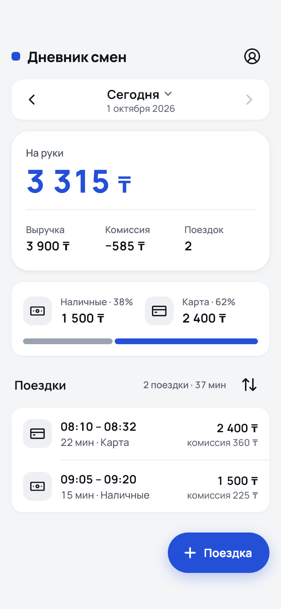 | 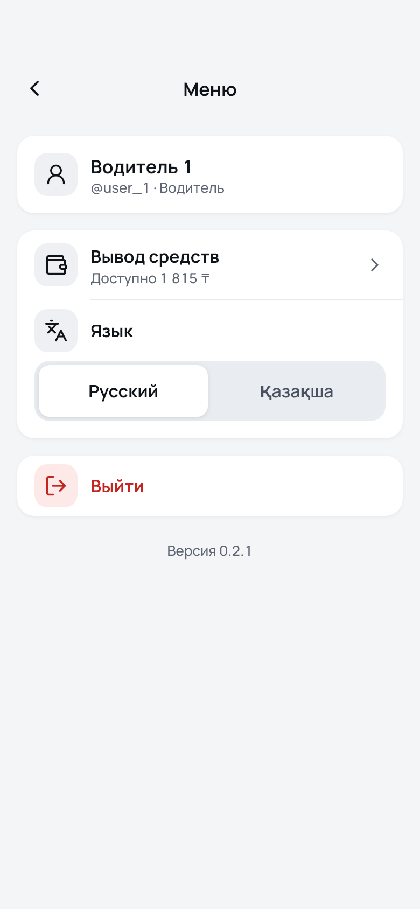 |  |  | 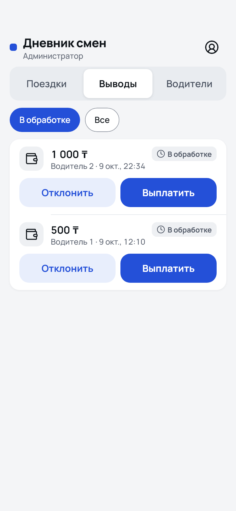 |

**Қазақша**

| Кіру | Күн | Мәзір | Қаражат шығару | Әкімші: сапарлар | Әкімші: шығарулар |
|---|---|---|---|---|---|
| 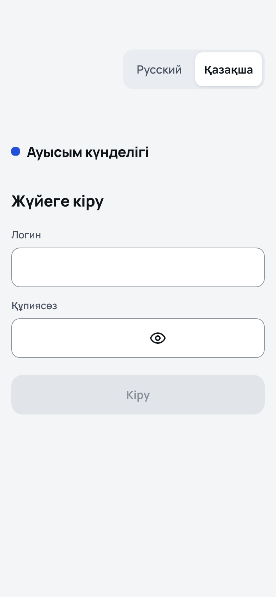 | 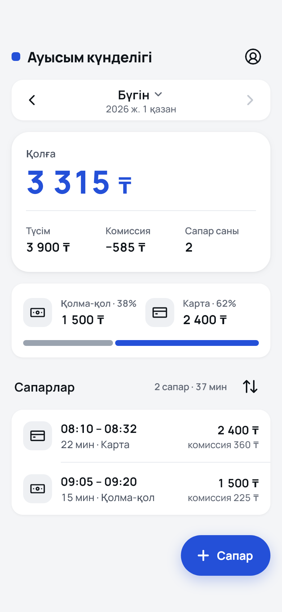 | 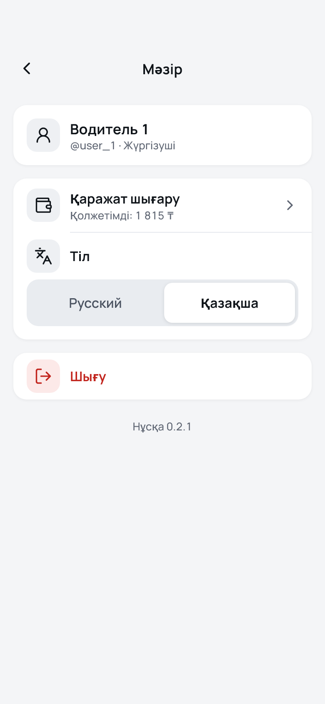 | 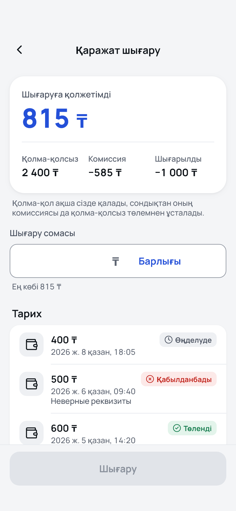 | 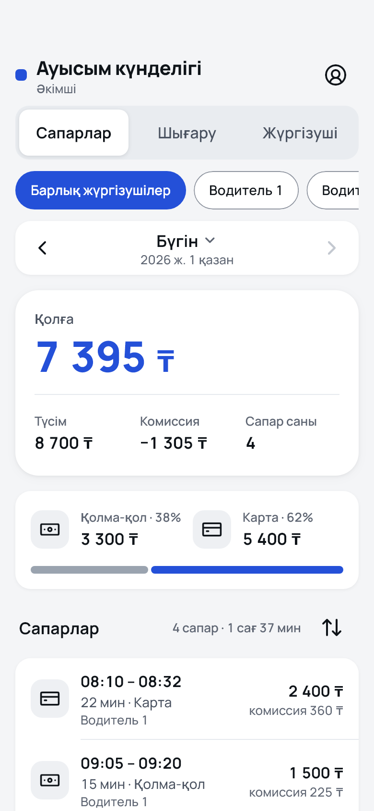 | 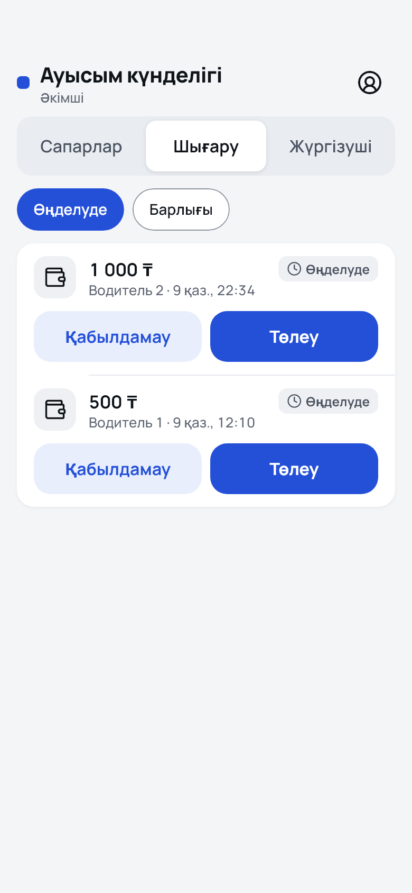 |

**Поездки**

| День | День, тёмная тема | Новая поездка | Нет связи | Конфликт 409 |
|---|---|---|---|---|
|  | 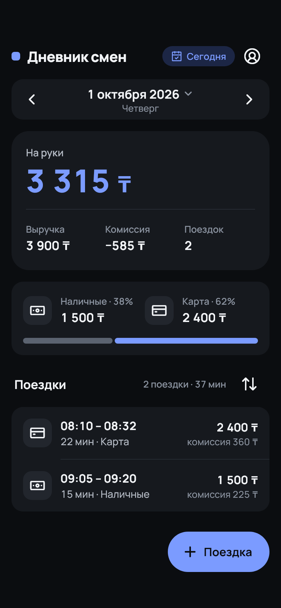 | 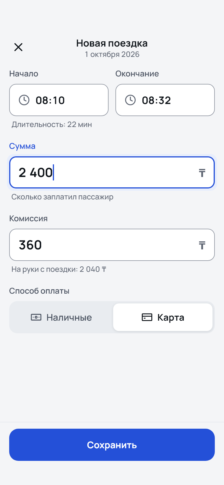 | 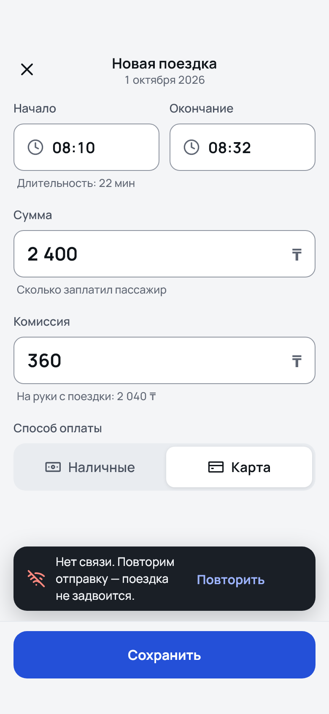 | 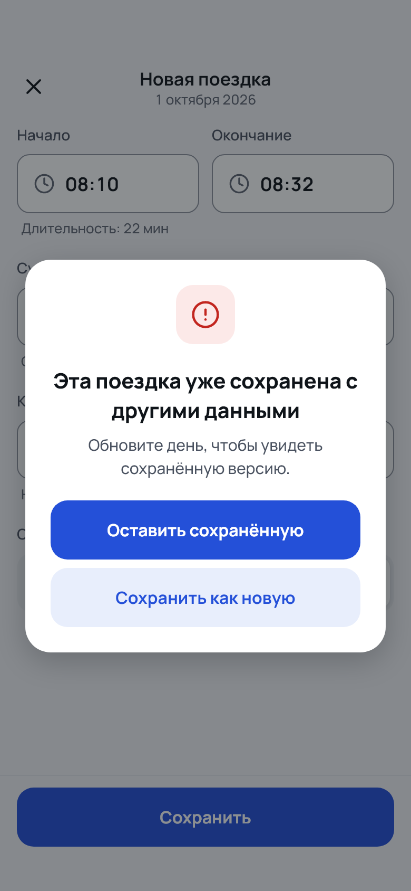 |

Все состояния новых экранов на обоих языках, светлые и тёмные, — в [`docs/design/accounts_app/`](docs/design/accounts_app).

Сравнение с макетами — в `docs/design/audit/` и [`docs/DESIGN_AUDIT.md`](docs/DESIGN_AUDIT.md).
