# UI stability audit (stage 1)

Question: does any interactive control change its size because of its label — Kazakh texts, a larger system font, a narrow phone? No code was changed for this audit. Date: 2026-10-12, commit `4b1b759` (v2.0).

## Method

`apps/mobile/test/audit/ui_stability_audit_test.dart` (runs only with `AUDIT_DIR` set; not part of CI):

- **Screens:** every app scenario (the mockup states, the stress states, the stage R5 behaviours and the §8 screens; 40 scenarios) × ru / kk × 360×780 / 390×844 × text scale 1.0 / 1.15 / 1.3 = 480 renders with the real fonts.
  - For each control, the harness finds its **body**: the box the kit constrains to the DESIGN.md height (e.g. the button's `minHeight: 56`). It records the body's actual height.
  - It checks every label inside the body: **wraps** (more than one line), **cut** (ellipsis or clipped at `maxLines`), **overflows** (drawn outside the body).
  - Field labels, helpers and errors are outside the body and are not counted.
- **Probes:** each kit control alone in a 328-wide column (360 dp minus the gutters), with a short real label and a long one (the longest real label ×3), ru / kk, ×1.0 / 1.15 / 1.3. The question is whether its size depends on the label.
- **Money:** every text with «₸» that wraps or is cut, wherever it is.
- Layout exceptions (RenderFlex overflow) on the screens: **0**. Every screen state lays out today; the problem is that controls **grow**, not that they break.

## Summary

1. **No text-carrying control has a fixed height.** Buttons, tabs, the language switch, the day switcher and fields set only a *minimum* height (DESIGN.md §4: «grows with text scale»). With real labels they grow as soon as the text no longer fits:
   - every button from ×1.15: 56 → 60, at ×1.3 → 63; text buttons 48 → 52 / 55;
   - the «+1 день» badge from ×1.15: 24 → 28 / 31; the time field with it: 56 → 62 / 68;
   - fields with a trailing button and the day switcher at ×1.3: 56 → 59 / 60;
   - list rows with a subtitle from ×1.15: 56 → 63 / 78.

   The language switch keeps 56 only because «Русский» / «Қазақша» are short: in the probe it grows like the tabs.
2. **Labels wrap instead of shrinking**, and a wrapped label makes its control taller:
   - admin tabs in Kazakh («Шығарулар», «Жүргізушілер») wrap at ×1.0 on a 360 dp phone: 56 → 64 / 70;
   - «Қабылдамау» (reject) wraps at ×1.0: decision buttons 48 → 72–86;
   - dialog buttons «Сохранить как новую поездку» / «Жаңа сапар ретінде сақтау» are two lines at ×1.0 (the earlier two-line rule): 56 → 80–94;
   - «Барлық сессияны тоқтату» in the driver sheet wraps at ×1.3.
3. **In isolation every text-carrying control either grows or overflows** with a long label (probe table). Full-width buttons, tabs, the language switch, list rows and the day switcher grow without limit (up to 3–4× their height). The inline «Всё» button, the FAB, the status chip, the snackbar action and the field's trailing button overflow (RenderFlex) instead.
   - The FAB and the status chip keep their height because nothing lets them wrap. Their width depends on the label.
   - The filter chips and the «Сегодня» button keep their size. The chip has a fixed 40 dp height and its row scrolls.
4. **Amounts wrap** (rule 7):
   - «−1 000 ₸» / «−1 305 ₸» in the balance and summary tiles at 360 dp ×1.3;
   - «комиссия 360 ₸» in every trip row at 360 dp ×1.3;
   - stress amounts («29 999 970 ₸») already at ×1.0.
5. **Nothing is cut or ellipsized anywhere.** No control has a one-line rule today, so long labels always wrap.

## Controls on screens: designed vs actual body height

Heights in dp, range over ru / kk and 360 / 390 dp. «place» = where the control sits.

| Control | Place | Designed | ×1.0 | ×1.15 | ×1.3 | Label |
|---|---|---|---|---|---|---|
| DkBadge | screen | 24 | 24 | 28 | 31 | grows |
| DkButton.compact | decision row | 48 | 48–72 | 52–80 | 55–86 | grows; wraps from ×1.0 at 360 dp (kk) |
| DkButton.primary | bottom bar | 56 | 56 | 60 | 63 | grows |
| DkButton.primary | dialog | 56 | 56 | 60 | 63–94 | grows; wraps from ×1.3 at 360 dp (kk) |
| DkButton.primary | screen | 56 | 56 | 60 | 63 | grows |
| DkButton.primary | state | 56 | 56 | 60 | 63 | grows |
| DkButton.secondary | dialog | 56 | 56–80 | 60–88 | 63–94 | grows; wraps from ×1.0 at 360 dp (ru) |
| DkButton.text | field trailing | 48 | 48 | 52 | 55 | grows |
| DkButton.text | screen | 48 | 48 | 52 | 55 | grows |
| DkDaySwitcher | screen | 56 | 56 | 56 | 60 | grows |
| DkFab | screen | 56 | 56 | 56 | 56 | stable |
| DkFilterChips | screen | 40 | 40 | 40 | 40 | stable |
| DkIconButton | field trailing | 48 | 48 | 48 | 48 | stable |
| DkIconButton | header | 48 | 48 | 48 | 48 | stable |
| DkIconButton | screen | 48 | 48 | 48 | 48 | stable |
| DkLanguageSwitch | screen | 56 | 56 | 56 | 56 | stable |
| DkListRow | screen | 56 | 56 | 56–63 | 56–78 | grows; wraps from ×1.3 at 360 dp (kk) |
| DkSegmentedControl | screen | 56 | 56 | 56–64 | 56–70 | grows; wraps from ×1.0 at 360 dp (kk) |
| DkStatusChip | screen | 24 | 24 | 24 | 24 | stable |
| DkTextField | dialog | 56 | 56 | 56 | 56 | stable |
| DkTextField | screen | 56 | 56 | 56 | 56–59 | grows |
| DkTimeField | screen | 56 | 56 | 56–62 | 56–68 | grows |
| DkTodayButton | header | 48 | 48 | 48 | 48 | stable |

Notes:
- **DkListRow** is not in the fixed-height list of the brief, but its title wraps («Барлық сессияны тоқтату»), and a row with a subtitle grows with the scale.
- **DkFilterChips** stays 40 dp in every run. It is the only control that is already fixed, because its `Container` has `height: 40`.
- **DkIconButton** stays 48: it has no label.

## Probes: does the size depend on the label?

Short label = a real one; long = the longest real label ×3. Width 328 dp.

| Control | Designed | Short label | Long label |
|---|---|---|---|
| DkButton.primary (full width) | 56 | 56 | **grows to 156 dp** (ru, ×1.3), 4 lines |
| DkButton.secondary (full width) | 56 | 56 | **grows to 156 dp** (ru, ×1.3), 4 lines |
| DkButton.text (full width) | 48 | 48 | **grows to 148 dp** (ru, ×1.3), 4 lines |
| DkButton.compact (decision row) | 48 | 48 | **grows to 164 dp** (kk, ×1.15), 5 lines |
| DkButton.text (inline «Всё») | 48 | 48 | **overflows** (RenderFlex overflow): the label pushes past the control instead of shrinking |
| DkFab | 56 | 56 | **overflows** (RenderFlex overflow): the label pushes past the control instead of shrinking |
| DkSegmentedControl (3 tabs) | 56 | 56 | **grows to 163 dp** (kk, ×1.3), 5 lines |
| DkLanguageSwitch | 56 | 56 | **grows to 101 dp** (ru, ×1.3), 3 lines |
| DkFilterChips | 48 | 48 | height unchanged (inline: the width follows the label, see the list below) |
| DkBadge | 24 | 24 | **grows to 62 dp** (ru, ×1.3), 2 lines |
| DkStatusChip | 24 | 24 | **overflows** (RenderFlex overflow): the label pushes past the control instead of shrinking |
| DkTodayButton | 48 | 48 | height unchanged (inline: the width follows the label, see the list below) |
| DkListRow | 56 | 56 | **grows to 171 dp** (ru, ×1.3), 5 lines |
| DkDaySwitcher | 56 | 56 | **grows to 226 dp** (kk, ×1.3), 5 lines |
| DkTextField (label + helper) | 56 box (+ label = 84) | 84 | **grows to 117 dp** (ru, ×1.3), 2 lines |
| DkTimeField | 56 box (+ label = 84) | 84 | **grows to 159 dp** (ru, ×1.3), 2 lines |
| DkDialogView buttons | 56 | 700 | measured on screens (see the table above: dialog buttons) |
| DkSnackbarView action | 56 | 64 | **overflows** (RenderFlex overflow): the label pushes past the control instead of shrinking |

## Money that wraps

| Kind | Scenario | First seen | |
|---|---|---|---|
| amount | `a10_withdraw` | from ×1.3 at 360 dp | **finding** |
| amount | `a11_withdraw_too_much` | from ×1.3 at 360 dp | **finding** |
| amount | `a12_withdraw_nothing` | from ×1.3 at 360 dp | **finding** |
| amount | `a13_withdraw_offline` | from ×1.3 at 360 dp | **finding** |
| amount | `a14_withdraw_created` | from ×1.3 at 360 dp | **finding** |
| amount | `a15_withdraw_conflict` | from ×1.3 at 360 dp | **finding** |
| amount | `a16_admin_trips_all` | from ×1.3 at 360 dp | **finding** |
| amount | `day_max_amounts` | from ×1.0 at 360 dp | **finding** |
| commission line | `01_day_light` | from ×1.3 at 360 dp | **finding** |
| commission line | `06_day_trip_added` | from ×1.3 at 360 dp | **finding** |
| commission line | `a06_day_header` | from ×1.3 at 360 dp | **finding** |
| commission line | `a16_admin_trips_all` | from ×1.3 at 360 dp | **finding** |
| commission line | `a17_admin_trips_driver` | from ×1.3 at 360 dp | **finding** |
| commission line | `day_max_amounts` | from ×1.0 at 360 dp | **finding** |
| commission line | `r5_day_refresh_failed` | from ×1.3 at 360 dp | **finding** |
| commission line | `r6_date_picker` | from ×1.3 at 360 dp | **finding** |
| commission line | `r7_sort_sheet` | from ×1.3 at 360 dp | **finding** |
| sentence | `a19_admin_reject_dialog` | from ×1.0 at 360 dp | allowed (message text) |

## Every case where a control's size depends on its label

1. `DkButton`, all variants and placements: full width, bottom bar, dialog, inline, compact (decision row) and text (field trailing, «Сегодня» in the date sheet). Height follows the label as soon as the label wraps or the scale is above 1.0.
2. `DkSegmentedControl` (admin tabs, payment method) and `DkLanguageSwitch`: height grows with wrapped segment labels and with the scale.
3. `DkDaySwitcher`: height grows at ×1.3 (title + subtitle), and without limit for long titles.
4. `DkTextField` / `DkTimeField`: the input box grows at ×1.3, and grows when the trailing «+1 день» badge wraps.
5. `DkBadge`: grows from ×1.15 and wraps in a narrow space.
6. `DkListRow`: the title wraps; rows with subtitles grow with the scale.
7. `DkFab`, `DkStatusChip`, `DkTodayButton`, filter chips: height fixed, **width** follows the label without a limit. With a long label the FAB and the status chip overflow.
8. Snackbar action and the field's trailing text button: overflow with a long label.
9. Summary / balance tiles and trip rows: amounts and the «комиссия …» line wrap at 360 dp ×1.3.

## Kazakh labels at risk (for stage 2, rule 8)

These wrap today at 360 dp ×1.0 or ×1.15. Under the new rules they would shrink, then end in an ellipsis. Shorter wordings will be proposed in `docs/L10N.md` once the stage 2 rules are in place and the ellipsis cases can be measured:

- `tabWithdrawals` «Шығарулар», `tabDrivers` «Жүргізушілер» (three tabs at 360 dp);
- `reject` «Қабылдамау» (half-width decision button);
- `conflictNew` «Жаңа сапар ретінде сақтау», `conflictKeep` «Сақталғанын қалдыру» (dialog buttons);
- `revokeSessions` «Барлық сессияны тоқтату» (sheet row).

## Worst cases (before)

In `docs/design/audit/stability/before/` (390 dp-wide renders at @2x of the 360 dp states):

- `01_day_light_kk_360_1.3.png`
- `11_add_trip_midnight_kk_360_1.3.png`
- `12_add_trip_conflict_409_kk_360_1.3.png`
- `12_add_trip_conflict_409_ru_360_1.0.png`
- `a01_login_kk_360_1.3.png`
- `a10_withdraw_kk_360_1.3.png`
- `a16_admin_trips_all_kk_360_1.0.png`
- `a16_admin_trips_all_kk_360_1.3.png`
- `a18_admin_withdrawals_kk_360_1.0.png`
- `a18_admin_withdrawals_kk_360_1.3.png`
- `a21_admin_driver_sheet_kk_360_1.3.png`

The worst five:

| Admin tabs, kk, 360 dp ×1.3 | 409 dialog, kk, ×1.3 | Decision buttons, kk, ×1.3 | Decision buttons, kk, ×1.0 | 409 dialog, ru, ×1.0 |
|---|---|---|---|---|
| 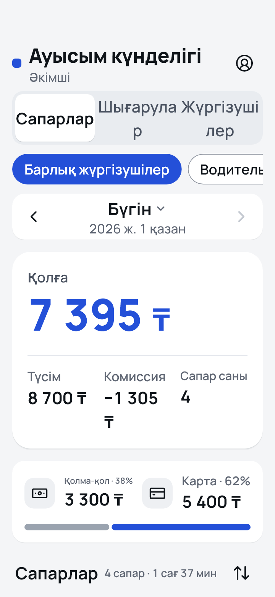 | 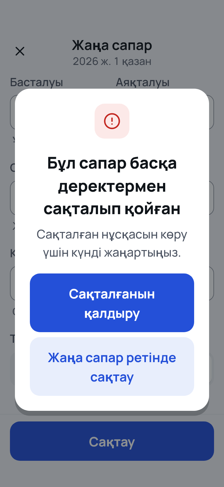 | 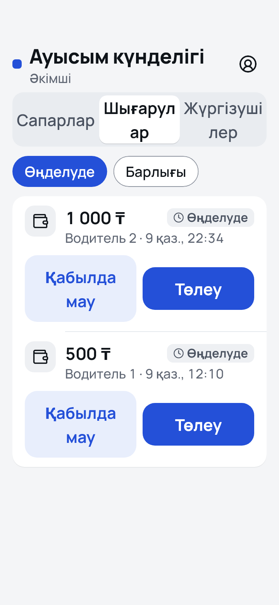 | 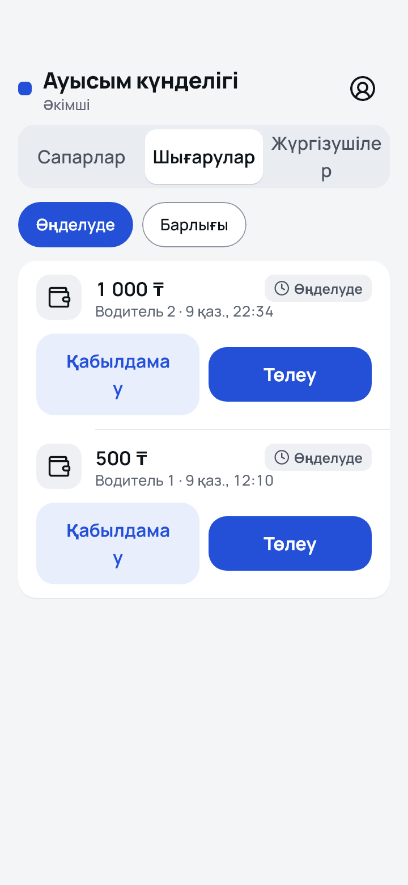 | 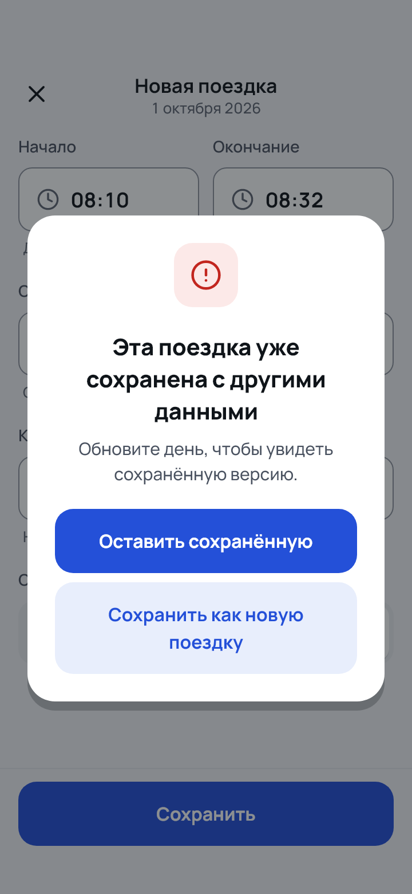 |

Reproduce:

```bash
cd apps/mobile
AUDIT_DIR=build/audit flutter test test/audit/ui_stability_audit_test.dart
AUDIT_DIR=build/shots AUDIT_SHOTS="a16_admin_trips_all|kk|360|1.3" flutter test test/audit/ui_stability_audit_test.dart
```

## After (stages 2–3, 2026-10-12)

The same harness on the fixed code (480 renders, 2 758 controls):

| | Before | After |
|---|---|---|
| Controls taller than designed | 540 | **0** |
| Controls whose label wraps | 86 | **0** |
| Layout exceptions | 0 | 0 |
| Amounts that wrap or are cut | 193 + 6 (stress) | **0** (only the reject dialog's title sentence wraps, allowed) |
| Cut labels | 0 (everything wrapped instead) | only «Сегодня» / «Бүгін» at ×1.3 (allowed: header priority) |
| Probes: size depends on the label | 15 of 18 controls | **0**, except the decision pair, which stacks by design (each button stays 48) |

What changed (DESIGN.md §10):
- every control from rule 2 has a fixed height;
- labels are one line: they shrink to 85 %, then use a short form or end in «…»;
- amounts and times are never cut;
- the decision buttons stack;
- the header title has priority over its actions;
- the text scale is clamped to ×1.3.

Copy shortened instead of cut: «Сохранить как новую», and the proposed Kazakh «Жаңа етіп сақтау», «Шығару», «Жүргізуші» (`docs/L10N.md`).

| State | Before | After |
|---|---|---|
| Admin tabs, kk, 360 dp ×1.3 |  | 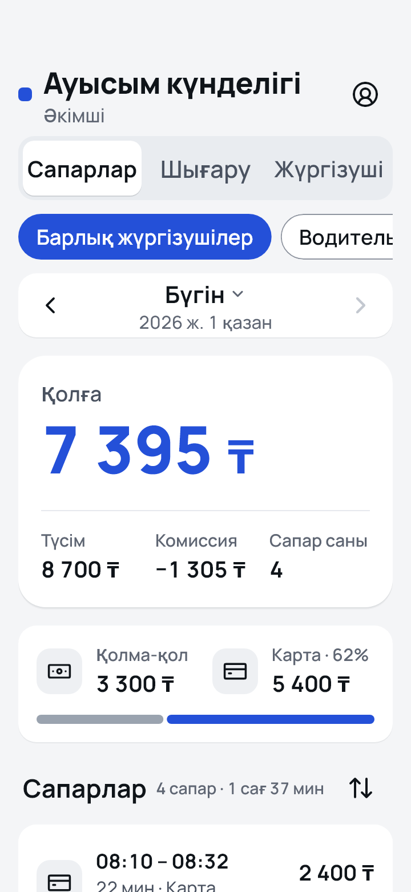 |
| 409 dialog, kk, ×1.3 |  | 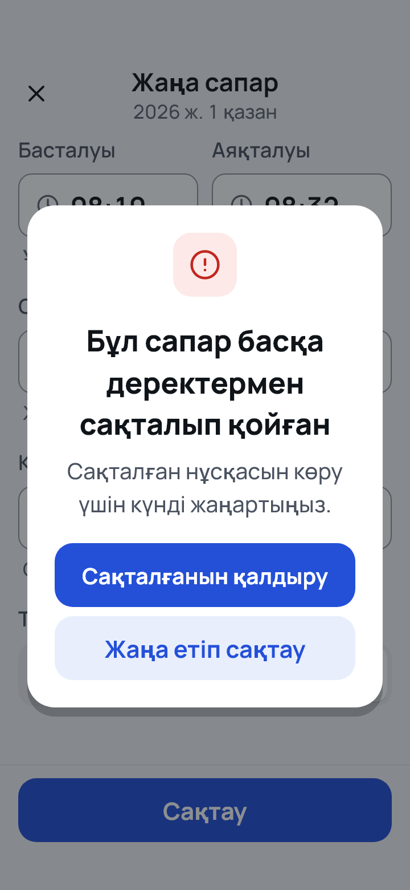 |
| 409 dialog, ru, ×1.0 |  | 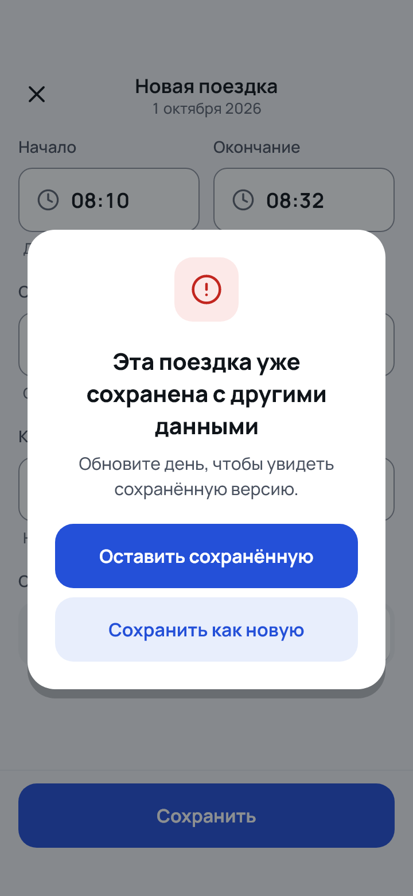 |
| Decision buttons, kk, ×1.3 |  | 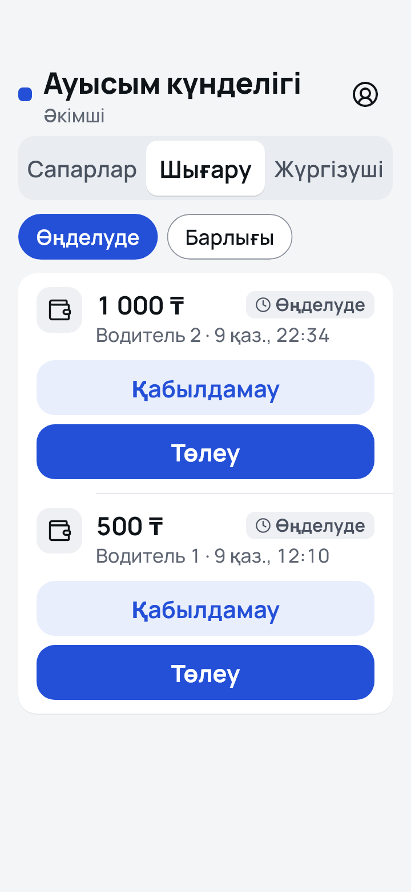 |
| Decision buttons, kk, ×1.0 |  | 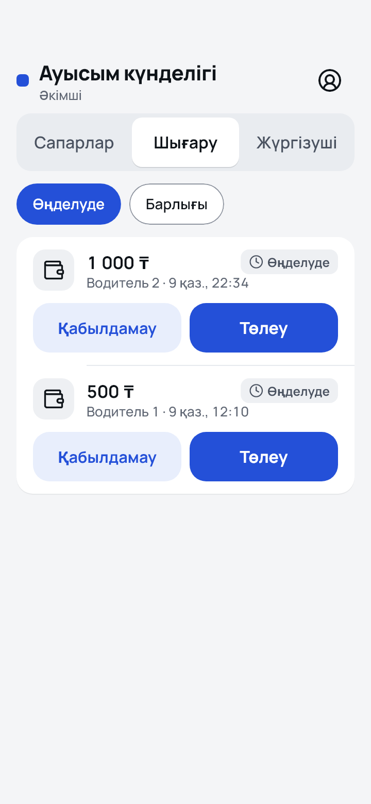 |
| «+1 күн» field, kk, ×1.3 | 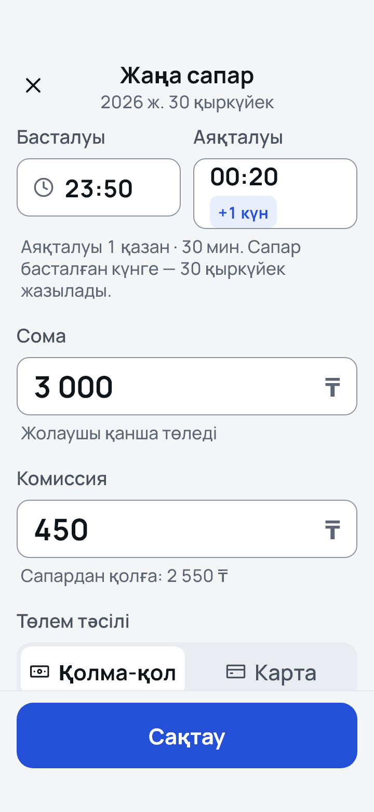 | 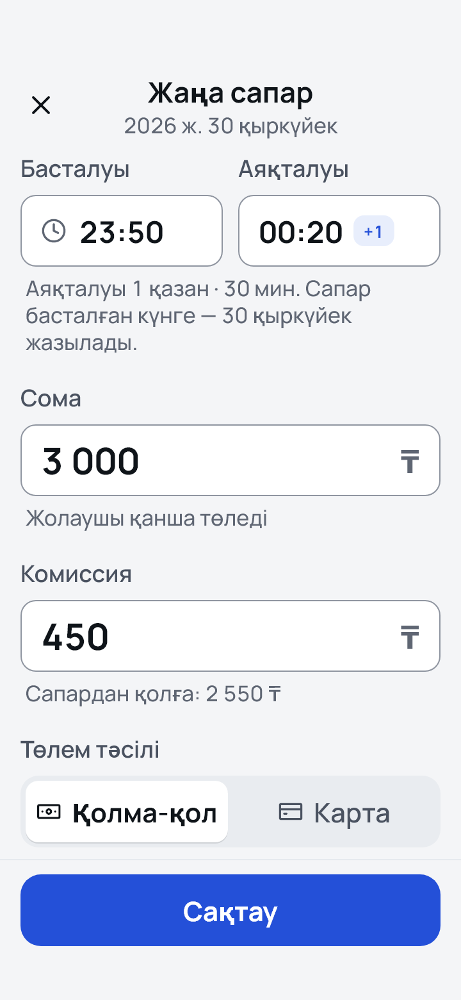 |

All «after» renders: `docs/design/audit/stability/after/`.
